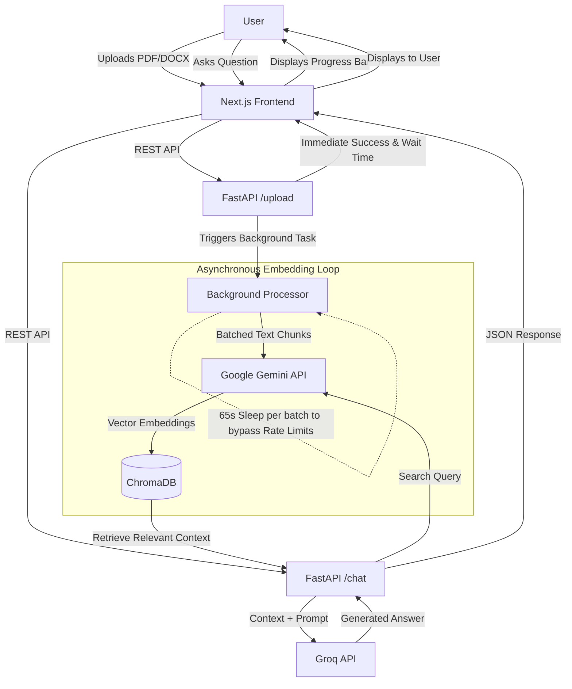

# Chat With Your Document (RAG Application)

A full-stack Retrieval-Augmented Generation (RAG) application that allows users to upload massive documents (PDF/DOCX up to 150+ pages) and ask questions about their contents in real-time. The system utilizes dynamic batching, asynchronous background tasks, and serverless cloud APIs to bypass free-tier rate limits and server timeouts, leveraging Groq's high-speed LLMs to synthesize accurate, context-aware answers.

## Architecture



## Features

- Massive Document Support: Safely process large documents (70+ pages) without triggering Render's 100-second HTTP timeouts using FastAPI BackgroundTasks.
- Dynamic Batching & Rate Limit Evasion: Intelligently calculates chunk sizes based on total page count and automatically pauses processing between batches to strictly adhere to Google Free Tier limits (30,000 tokens/min).
- Synchronized Progress UI: The Next.js frontend captures estimated backend wait times to generate a precise, synchronized progress bar that unlocks the chat only when embedding is 100% complete.
- Free & Fast AI: Leverages Groq's API for lightning-fast inference using active models like openai/gpt-oss-120b and qwen/qwen3-32b.
- Automatic Fallback: Gracefully cycles through a sequence of active LLMs if a specific model experiences downtime.
- Serverless Embeddings: Uses Google Gemini's generous free tier (gemini-embedding-2-preview) to generate embeddings in the cloud, keeping backend memory usage well below Render's 512MB RAM cap.
- In-Memory Vector Search: Utilizes ChromaDB for rapid similarity search without requiring an external database connection.

## Tech Stack

- Frontend: Next.js (App Router), React, Tailwind CSS (Vercel)
- Backend: FastAPI, Uvicorn, Python (Render Web Service)
- Orchestration: LangChain
- LLM Provider: Groq API
- Embeddings: Google Gemini API
- Vector Store: ChromaDB

## Environment Variables

To run this project, you will need to add the following environment variables. 

Backend (.env in root directory):
- GROQ_API_KEY: Your free API key from the Groq Console.
- GOOGLE_API_KEY: Your free API key from Google AI Studio.

Frontend (.env.local in /frontend directory):
- NEXT_PUBLIC_API_URL: The URL of your FastAPI backend (e.g., http://127.0.0.1:8000 for local dev, or your production Render URL without a trailing slash).

## Local Development Setup

### 1. Backend Setup
Open your first terminal and run the following commands:

```bash
# Navigate to project root
cd "chat with you document"

# Create and activate virtual environment
python -m venv venv
.\venv\Scripts\Activate.ps1  # Windows PowerShell
# source venv/bin/activate   # macOS/Linux

# Install dependencies
pip install -r requirements.txt

# Start the server
uvicorn main:app --reload --port 8000
```

### 2. Frontend Setup
Open a second terminal and run the following commands:

```bash
# Navigate to the frontend directory
cd "chat with you document/frontend"

# Install dependencies
npm install

# Start the development server
npm run dev
```